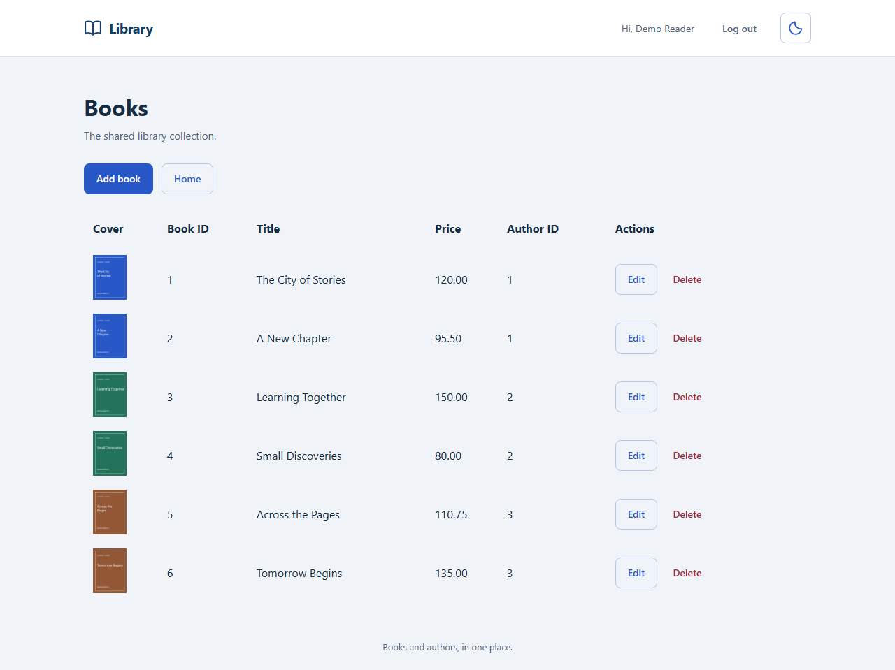
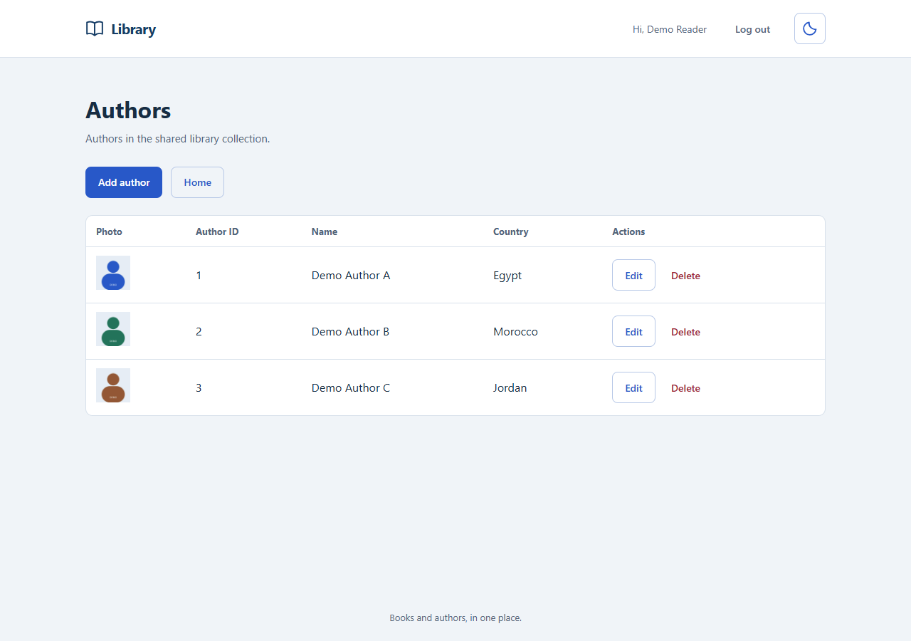
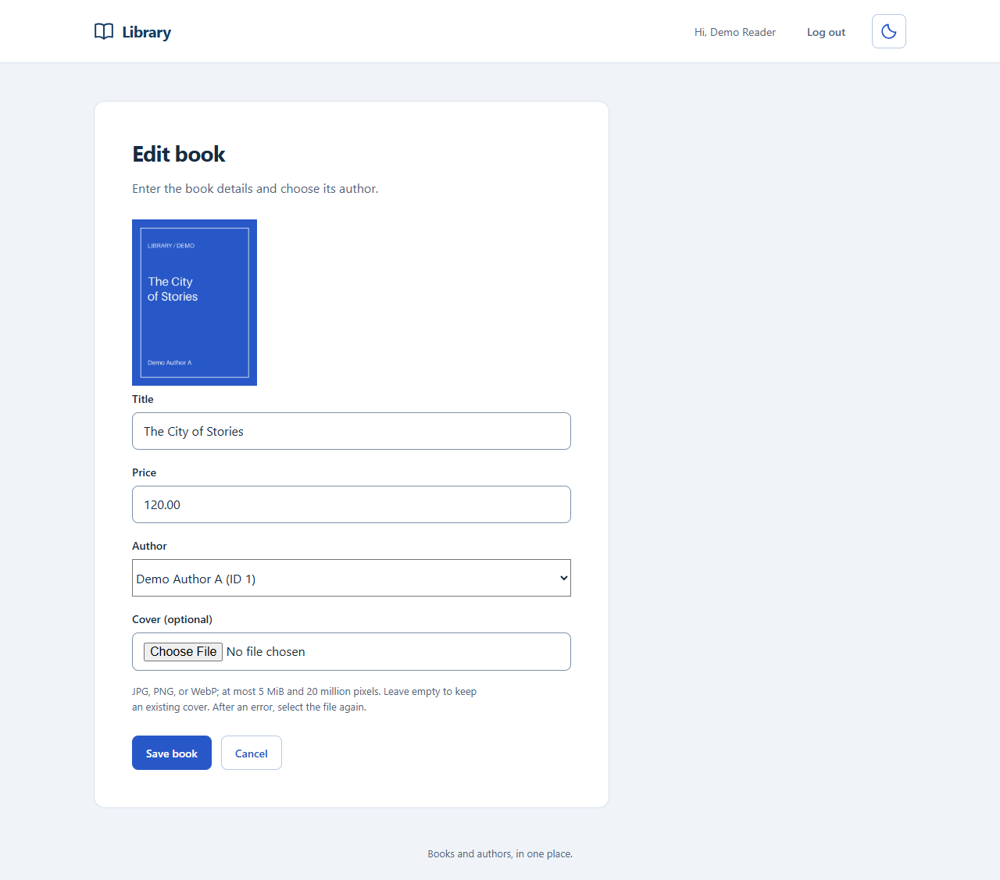
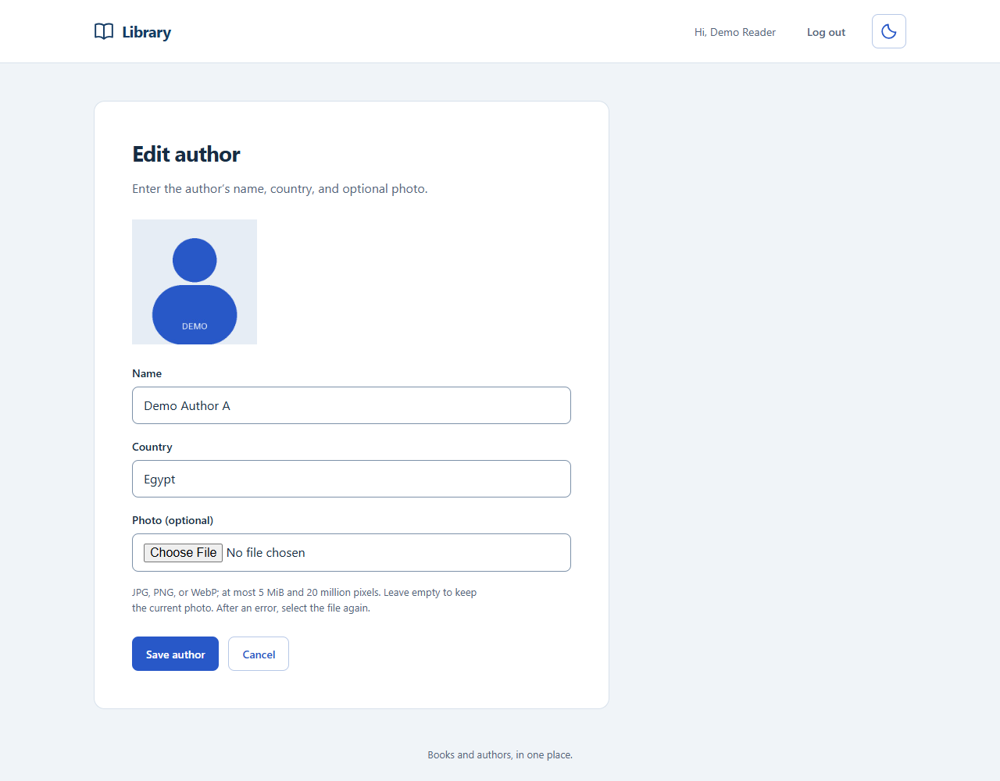
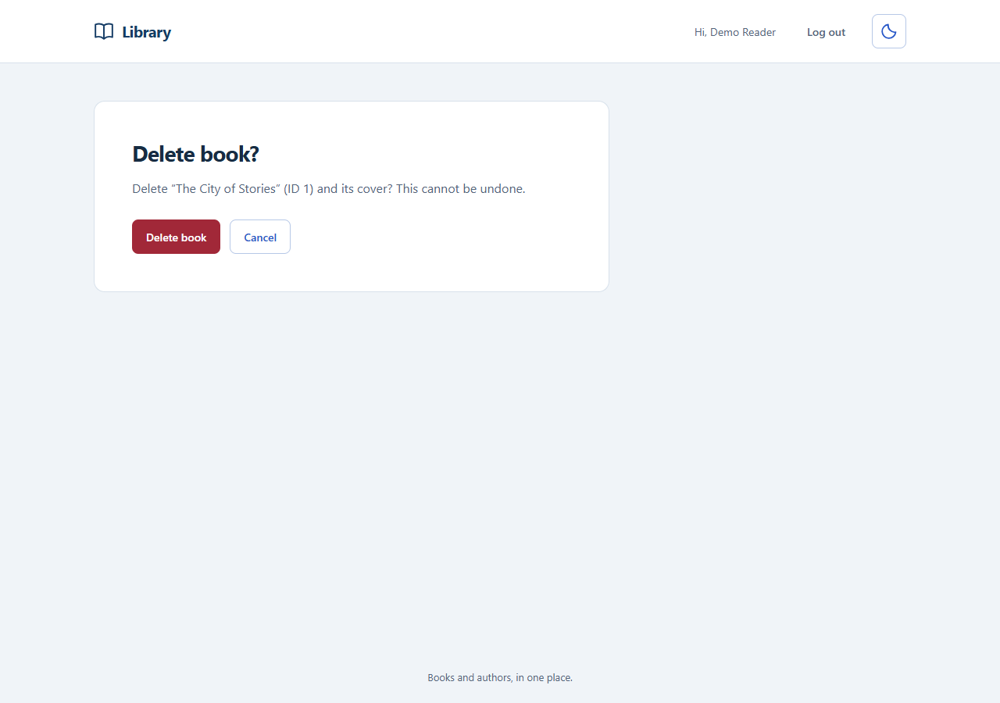
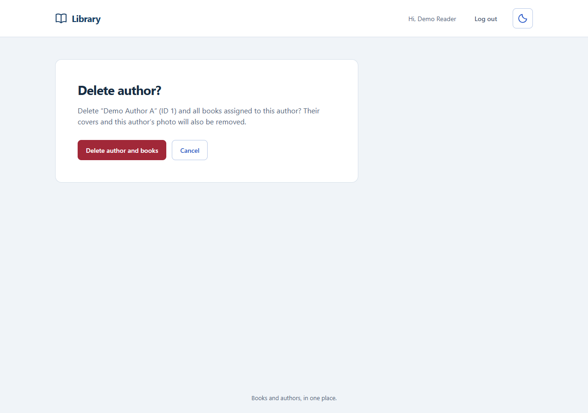
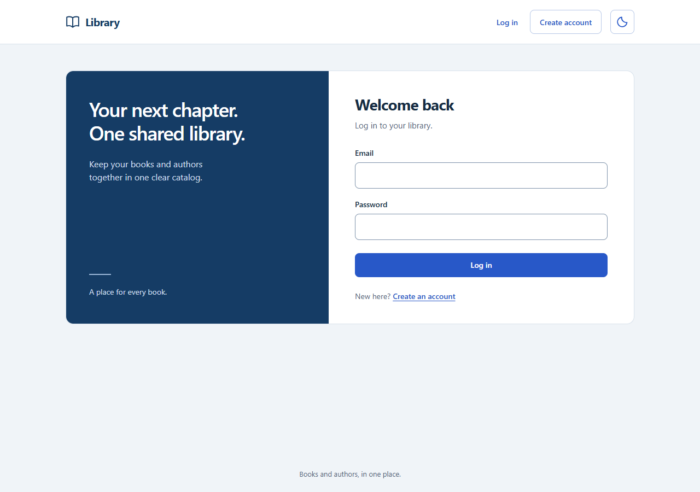
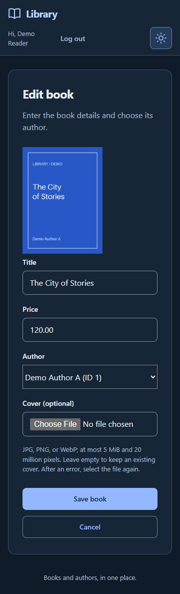

# Library Application — Database Lab 3

## 1. Project description

A shared library application built with **Flask, Jinja, plain CSS, minimal JavaScript, PyMySQL, and MySQL**. Users can register, log in, and manage books and authors, including optional book covers and author photos.

Each book belongs to an author. Deleting an author also deletes their books and removes the related image files. Library records are shared between authenticated users.

The project contains two separate database exercises:

- **Problem 1:** a company database with employee, department, and project tables, seed data, and answers to Q1.1–Q1.3.
- **Problem 2:** the library database and website. The catalog uses `AUTHOR(author_id, name, country, photo_filename)` and `BOOK(book_id, title, price, author_id, cover_filename)`.
- **Authentication:** accounts are stored separately in `registration.users`. Existing Lab 2 accounts can be reused.

## 2. Contributors

| Name | ID | Contributions |
| --- | --- | --- |
| Moustafa Mohamed | 2304252 | Books CRUD and covers, BOOK schema/seeds, app configuration/database setup, shared image helper, book/helper tests, backend documentation |
| Ibrahim Hossam | 2304248 | Authors CRUD and photos, AUTHOR schema/seeds, authentication, shared layout/themes, protected media, upload handling, author/cascade tests |

## 3. Run the project

**Required:** Windows PowerShell, Git, Python 3.14, and MySQL 8.4 with `mysql` on PATH.

### Step 1 — Clone

```powershell
git clone https://github.com/moustafa-ash/Library-Application.git
Set-Location Library-Application
```

### Step 2 — Install dependencies

```powershell
py -3.14 -m venv .venv
.\.venv\Scripts\python.exe -m pip install -r website/requirements.txt
```

### Step 3 — Configure

```powershell
if (-not (Test-Path website/.env)) {
    Copy-Item website/.env.example website/.env
}

.\.venv\Scripts\python.exe -c "import secrets; print(secrets.token_hex(32))"
notepad website/.env
```

Enter your MySQL credentials and the generated secret. Keep `.env` private.

```dotenv
DB_HOST=localhost
DB_PORT=3306
DB_USER=your_mysql_username
DB_PASSWORD=your_mysql_password
DB_NAME=library
AUTH_DB_NAME=registration
SECRET_KEY=paste_your_generated_secret_here
```

### Step 4 — Set up MySQL

If stopped, start the service in **administrator PowerShell**. Use your service name if different:

```powershell
Get-Service -Name "*MySQL*"
Start-Service -Name "MySQL84"
```

From the repository root, connect using your `.env` settings. Replace `root` with your username:

```powershell
mysql --host=localhost --port=3306 --user=root --password
```

For a **new catalog**, run inside the MySQL client:

```sql
SOURCE website/database/auth.sql;
SOURCE problem2_DDL.sql;
SOURCE problem2_DML.sql;

SELECT COUNT(*) AS authors FROM library.AUTHOR;
SELECT COUNT(*) AS books FROM library.BOOK;
EXIT;
```

Expected: **3 authors, 6 books**. In DBeaver, execute the same three files in that order.

<details>
<summary>Existing catalog</summary>

Skip library DDL/seeds if the tables already exist. Only if `AUTHOR.country` is missing, run this once:

```sql
SOURCE website/database/add_author_country.sql;
```

Existing countries become `Unknown`; update them through **Browse authors**.

</details>

<details>
<summary>Problem 1 — separate from the website</summary>

**The DDL deletes and recreates `company`. Preserve any existing data before running it.**

Inside the MySQL client:

```sql
SOURCE problem1_DDL.sql;
SOURCE problem1_DML.sql;

SELECT COUNT(*) FROM company.EMPLOYEE;
SELECT COUNT(*) FROM company.DEPARTMENT;
SELECT COUNT(*) FROM company.PROJECT;
```

Expected: **3 rows per table**. Run the SQL blocks in [problem1_Answers.txt](problem1_Answers.txt) separately; do not `SOURCE` the text file. Q1.3 requires empty tables.

</details>

### Step 5 — Run Flask

Back in the repository-root PowerShell terminal:

```powershell
.\.venv\Scripts\python.exe -m flask --app website/run.py check-db
.\.venv\Scripts\python.exe -m flask --app website/run.py run
```

Open **http://127.0.0.1:5000** and register or log in. Stop Flask with **Ctrl+C**.

<details>
<summary>Tests</summary>

```powershell
.\.venv\Scripts\python.exe -m pip check
.\.venv\Scripts\python.exe -m unittest discover -s website/tests -t website
```

Normal runs skip 11 optional MySQL checks.

</details>

## 4. Features

| Category | Implemented features |
| --- | --- |
| Authentication and security | Registration, login/logout, hashed passwords, server-side sessions, protected pages/media, CSRF-protected writes, parameterized SQL, and escaped template output. |
| Book management | Shared book table with ID, title, price, and author ID; add, edit, and delete books; author selector; validation; unchanged-update support; delete confirmation. |
| Author management | Shared author table with ID, name, and country; add, edit, and delete authors; validation; confirmation before cascading book deletion; related photo/cover cleanup. |
| Images | Optional book covers and author photos; preview and thumbnails; retain or replace images; JPG/JPEG, PNG, and WebP checks; 5 MiB/file, 6 MiB/request, and 20-million-pixel limits; normalized JPEG storage; protected serving; readable missing-image states; oversized-upload recovery. |
| Database exercises, interface, and checks | Both SQL exercises and seeds; Q1.1–Q1.3 answers/output; separate authentication/catalog databases; light/dark themes; responsive tables/forms; keyboard navigation; forms usable without JavaScript; unit, real MySQL, browser, and CI checks. |

## 5. Screenshots

These are screenshots of the actual running application with disposable demo records. Covers and author avatars are illustrative demo assets; no private accounts or credentials are shown.

### Browse books and authors

| Books: six records with covers and author IDs | Authors: names, countries, and photos |
| --- | --- |
|  |  |

### Edit records and images

The same forms support creation; editing also shows the current image.

| Book details and current cover | Author details, country, and current photo |
| --- | --- |
|  |  |

### Confirm deletions

| Remove one book | Remove an author and related books |
| --- | --- |
|  |  |

### Authentication and mobile dark theme

| Log in | Responsive book form at 360 pixels |
| --- | --- |
|  |  |
